# Cipherly

Cipherly is a Flutter chat app with end-to-end encryption. Messages go **directly between devices** over WebRTC and are sealed with keys that never leave the device. You sign in with any email address and a one-time verification code. There are no passwords.

| Light mode | Dark mode |
|---|---|
| 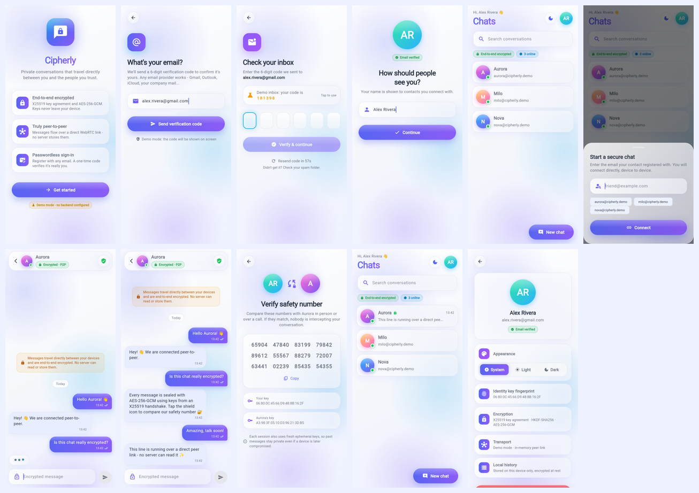 | 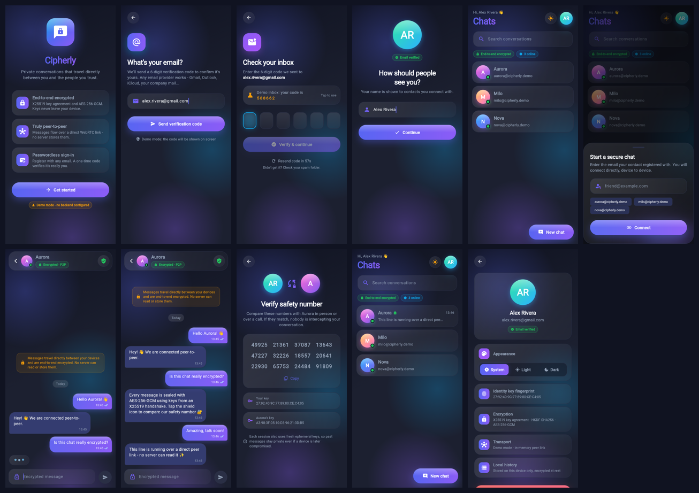 |

| | Welcome | Verify code | Chats | Chat | Settings |
|---|---|---|---|---|---|
| Light | 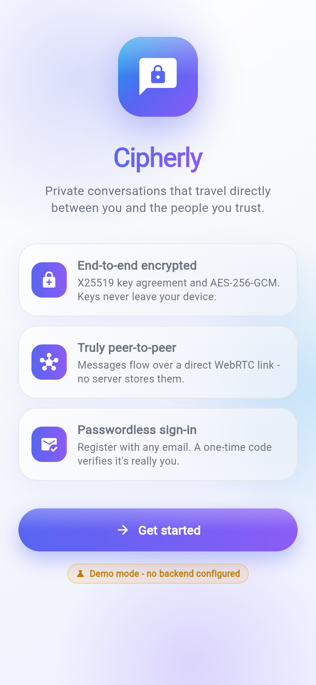 | 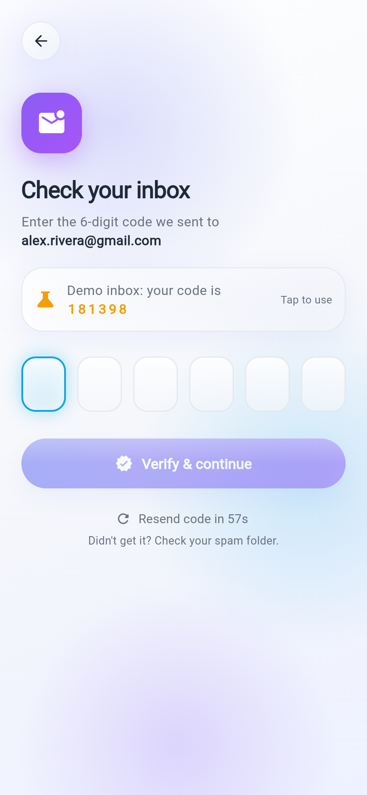 | 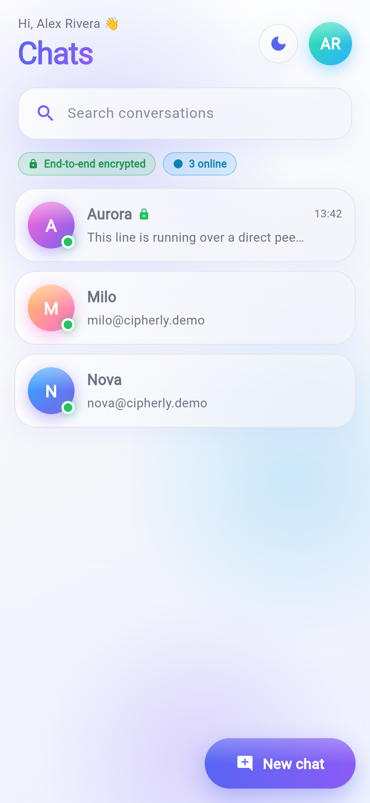 | 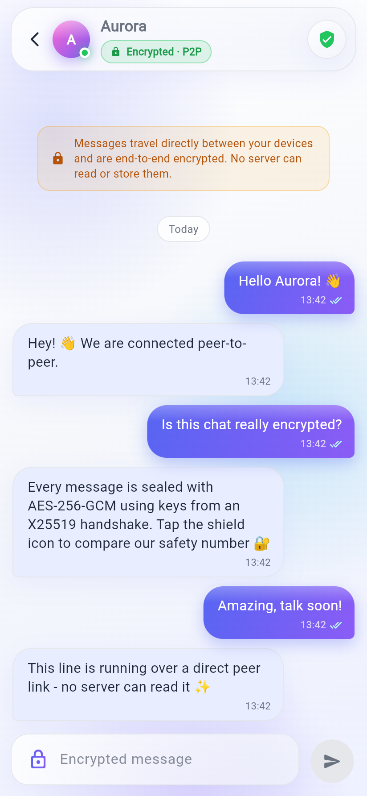 | 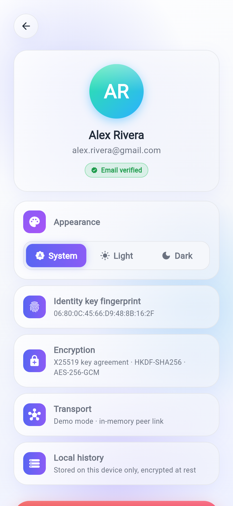 |
| Dark | 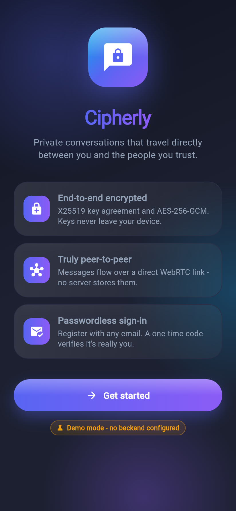 | 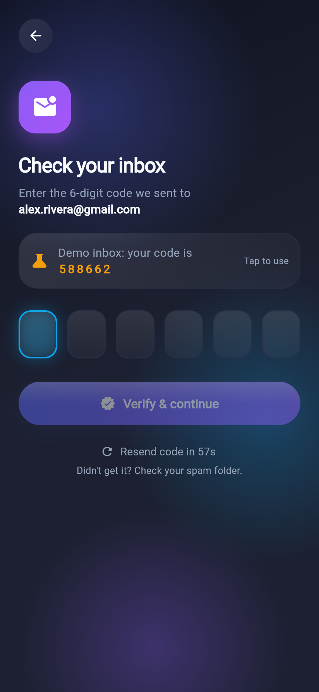 | 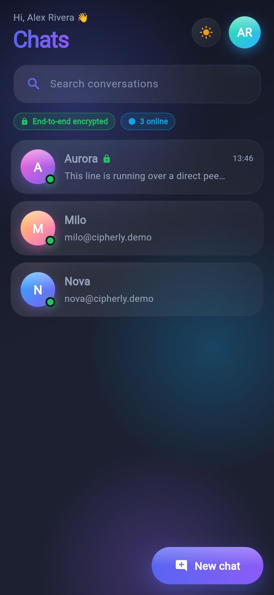 | 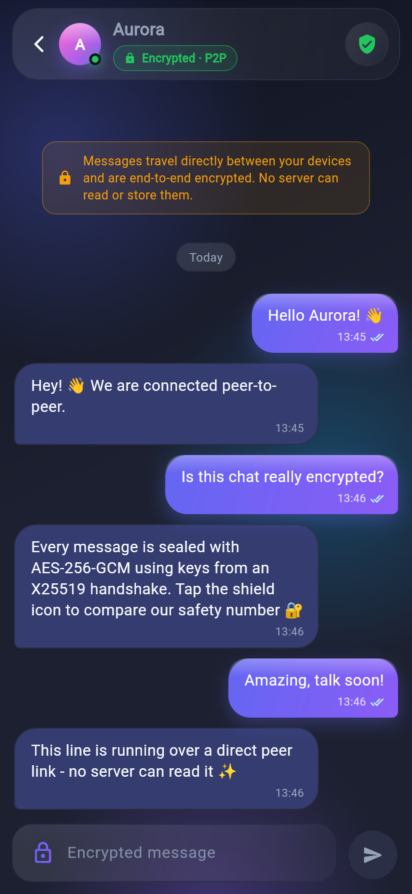 | 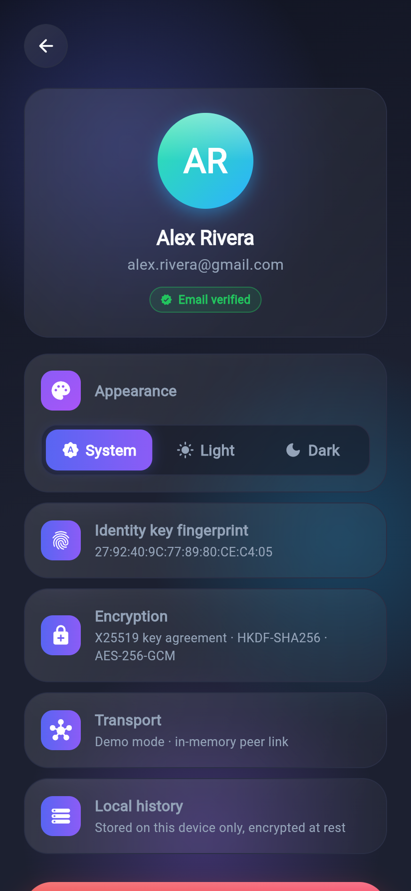 |

## Features

- **Email registration with verification.** Enter any email address (Gmail, Outlook, iCloud, a work address, and so on). The app sends a 6-digit code to that address, and entering it verifies the address and signs you in. Your account is created the first time you verify.
- **Peer-to-peer.** Chats run over a WebRTC data channel. The server only helps the two devices find each other (signaling); it never sees or stores messages.
- **End-to-end encryption.** An authenticated X25519 key exchange creates the session keys and every message is sealed with AES-256-GCM (details below). You can compare a **safety number** with your contact to confirm nobody is intercepting the chat.
- **Glossy UI with light and dark themes.** Uses the NEXA palette (see Theming below). Glass-style panels, animated gradient backgrounds, gradient message bubbles, a 6-box code input, online indicators, typing indicators, and delivered ticks. The app follows the system setting by default; you can switch with the sun/moon button on the Chats screen or under **Settings → Appearance** (System / Light / Dark), and the choice is remembered.
- **Chat history stays on the device** and is encrypted at rest (AES-GCM, with the key kept in the platform keystore).
- **Demo mode.** With no backend configured, the app still runs: the verification code appears on screen and three demo contacts (Aurora, Milo and Nova) chat back through the real encryption code.

## Quick start (demo mode)

```bash
flutter pub get
flutter run            # any device, or: flutter run -d chrome
```

## Production setup (Supabase)

1. Create a project at [supabase.com](https://supabase.com).
2. **SQL Editor:** run [`supabase/schema.sql`](supabase/schema.sql). It creates the `profiles` directory table and its row-level security rules.
3. **Authentication → Providers → Email:** turn Email on and keep *Confirm email* on.
4. **Authentication → Email Templates → Magic Link:** put `{{ .Token }}` in the template so users get a code instead of a link, for example:
   ```html
   <h2>Your Cipherly code</h2>
   <p>Enter this code to verify your email: <strong>{{ .Token }}</strong></p>
   <p>The code expires in 10 minutes.</p>
   ```
   To use 6-digit codes, set *Email OTP Length* to 6 under **Authentication → Providers → Email**.
5. **Authentication → SMTP Settings:** set up your own SMTP provider (Resend, SendGrid, SES, and so on). Supabase's built-in mailer is heavily rate-limited.
6. Run the app with your project credentials:
   ```bash
   flutter run \
     --dart-define=SUPABASE_URL=https://YOUR-PROJECT.supabase.co \
     --dart-define=SUPABASE_ANON_KEY=YOUR-ANON-KEY
   ```
   Optional: add a TURN server for users behind strict NATs or firewalls:
   `--dart-define=TURN_URL=turn:turn.example.com:3478 --dart-define=TURN_USERNAME=... --dart-define=TURN_CREDENTIAL=...`

## Theming

All colors live in [`lib/ui/theme/app_theme.dart`](lib/ui/theme/app_theme.dart).

- `AppColors` holds the colors shared by both modes: brand (Indigo `#5865F2`, Violet `#8B5CF6`, Sky `#0EA5E9`, Teal `#14B8A6`), status (Success `#22C55E`, Warning `#F59E0B`, Error `#EF4444`, Info `#0EA5E9`, Purple `#A855F7`) and the gradients built from them.
- `AppPalette` is a `ThemeExtension` with the colors that differ by mode. Widgets read it with `context.palette`:

| Token | Light | Dark |
|---|---|---|
| Background | `#FFFFFF` | `#101321` |
| Surface | `#F5F7FB` | `#1C2030` |
| Chat bubble (received) | `#E8EDFF` | `#343C70` |
| Chat bubble (sent) | `#5865F2` | `#6366F1` |
| Text primary | `#1F2937` | `#F8FAFC` |
| Text secondary | `#6B7280` | `#94A3B8` |
| Divider | `#E5E7EB` | `#2A2F45` |

Sent bubbles and primary buttons use an indigo → violet gradient. Warning-colored text uses a darker amber in light mode so it stays readable. `ThemeController` stores the System / Light / Dark choice.

## How it works

```
 Alice's device                     Supabase                      Bob's device
 ──────────────                     ────────                      ────────────
 email + code  ───── Auth (OTP) ──▶  verifies email
 identity pubkey ─── profiles ────▶  directory  ◀──── lookup by email ───
 SDP offer/ICE ───── Realtime ────▶  signal:<bob>  ──────────────────────▶
 ◀════════════════ WebRTC data channel (direct, DTLS) ═══════════════════▶
        hello{eph}  ⇄  hello{eph}        →  X25519 triple-DH + HKDF
        AES-256-GCM frames (counter-bound, replay-protected)
```

### Cryptography (`lib/services/crypto/e2e_crypto.dart`)

| Step | Details |
|---|---|
| Identity key | X25519 key pair created on the device and stored in the Keychain, Keystore or libsecret. Only the public key is published. |
| Handshake | For each session, both peers send a fresh ephemeral key. The shared secret combines `DH(eI,eR) ‖ DH(iI,eR) ‖ DH(eI,iR)`. This gives forward secrecy and mutual authentication, because both identity keys come from the directory, not from the network. |
| Key derivation | HKDF-SHA256 with salt `eI‖eR`, producing separate keys for each direction. |
| Messages | AES-256-GCM with a random 96-bit nonce. The associated data includes the direction and a counter that must keep increasing, so replayed or reordered frames are rejected. |
| Key confirmation | An encrypted `confirm` frame must decrypt before the link is shown as **Encrypted · P2P**. A wrong or substituted key makes the handshake fail. |
| Safety number | SHA-512 of both identity public keys in a fixed order, shown as 60 digits. |

## Project layout

```
lib/
  core/config.dart               build-time config (dart-define), demo-mode switch
  models/models.dart             AppUser, PeerProfile, ChatMessage, LinkState
  services/
    auth/                        AuthService + Supabase email-OTP and demo implementations
    crypto/e2e_crypto.dart       identity keys, SessionCipher, safety numbers
    directory/                   user directory (profiles table / in-memory)
    signaling/                   Supabase Realtime broadcast + presence
    p2p/transport.dart           transport abstraction
    p2p/webrtc_link.dart         WebRTC data-channel transport, offer/answer/ICE, glare handling
    p2p/secure_channel.dart      handshake + encrypted framing over any transport
    storage/secure_store.dart    keystore secrets + encrypted local history
    demo/demo_backend.dart       in-memory transport and demo contacts
    backend.dart                 wires Supabase or demo services together
  state/chat_controller.dart     contacts, conversations, link lifecycle
  ui/                            theme, glass widgets, screens
supabase/schema.sql              database schema + RLS
test/secure_channel_test.dart    crypto and channel tests
test/theme_test.dart             palette values and theme switching
```

## Testing

```bash
flutter analyze
flutter test
```

## Limitations

- Because messages go directly between devices, **both people must be online** to exchange them. Messages typed while the contact is offline wait on your device and are sent when the link reconnects.
- Some networks block direct connections (symmetric NAT, corporate firewalls). These need a TURN relay. TURN only relays already-encrypted traffic.
- Signed-in users can see who is online (presence) and look up profiles by exact email address.
- Message history stays on the device; there is no backup or sync across devices.
